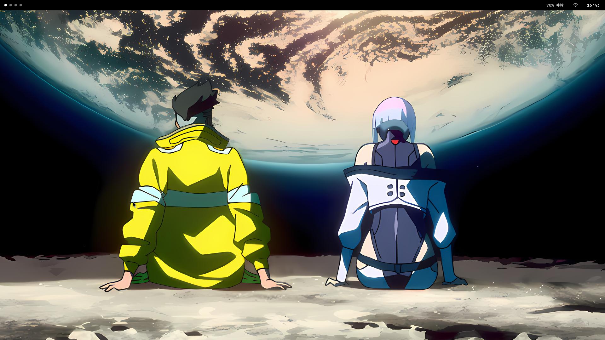
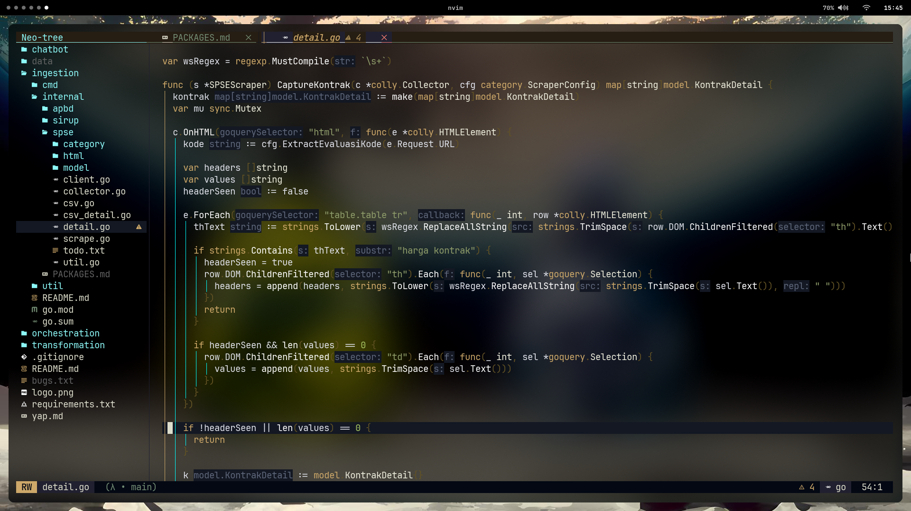
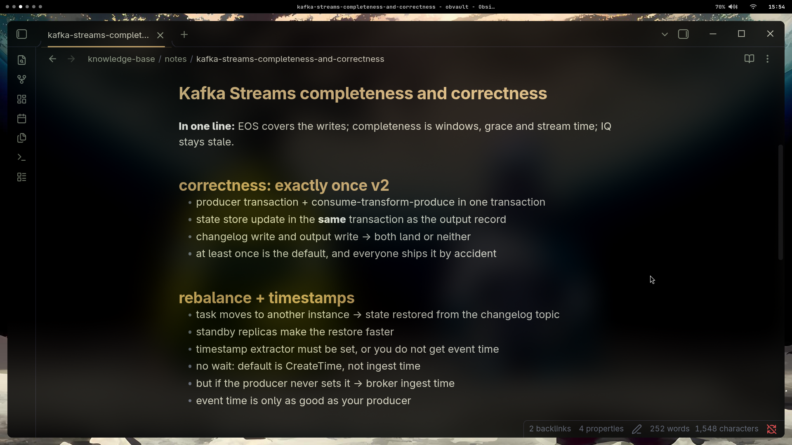

# fedora

goated fedora 44 workstation setup made with love :) compositor is sway, works for dual monitor. just use good bg wallpaper, add less opacity then blur the program's bg, everything will be just as good as neovim's. love you

## Preview

**1. Idle**

<p align="center"></p>

| **2. Neovim** | **3. Obsidian** |
|:--:|:--:|
|  |  |

## Fresh machine

```sh
sudo dnf install -y git stow zsh fzf
git clone git@github.com:dosedaf/fedora.git ~/fedora
~/fedora/scripts/install.sh
```

Then:

1. `chsh -s /usr/bin/zsh`
2. pick packages: `scripts/pick-packages.sh dnf`, repeat for `flatpak`/`brew`/`npm`/`uv`, then `scripts/install-selected.sh`
3. non-manager installs: `packages/manual.md`
4. secrets: decrypt the backup into `$HOME`
5. shell plugins: oh-my-zsh + `zsh-autosuggestions` + `zsh-syntax-highlighting`
6. nvim: `:Lazy sync`, then `:Mason`
7. hex: install Hex, then `scripts/hex-settings-restore.sh` (save changes back with `scripts/hex-settings-save.sh`)
8. `sudo dnf install restic` and restore data (separate backup)

## Configs

Every directory is a [stow](https://www.gnu.org/software/stow/) package rooted here and linked into `$HOME`.

| Path | What |
|---|---|
| [zsh/](zsh/) | shell, aliases, `y()`, `secrets.example.zsh` |
| [nvim/](nvim/) | LazyVim + extras (dap, test, python, go, sql), Satellite theme, neo-tree |
| [wezterm/](wezterm/) | Wezterm config: Satellite palette, JetBrainsMono NFM, opacity |
| [yazi/](yazi/) | minimal yazi config |
| [btop/](btop/) | btop config |
| [sway/](sway/) | sway session, waybar, mako, wofi, `environment.d`, helper scripts |
| [hex/](hex/) | Hex dictation settings snapshot (applied by `scripts/hex-settings-restore.sh`, not stowed) |
| [gnome/](gnome/) | dconf dumps, monitors, mimeapps, autostart, wallpaper |
| [fonts/](fonts/) | JetBrainsMono Nerd Font |
| [packages/](packages/) | snapshots + picker |
| [scripts/](scripts/) | install / restore / package helpers |
